


 

 


I'm a **Software Engineering student at Daffodil International University** and a **Full-Stack Developer** based in Dhaka, Bangladesh 🇧🇩. I turn ideas into fast, accessible and scalable products, from e-commerce and education platforms to corporate websites and AI-powered apps.




<table>
<tr>
<td><a href="https://mama-bazar.com/"></a></td>
<td><a href="https://microlearning-beta.vercel.app/home"></a></td>
</tr>
<tr>
<td><a href="https://oriyet.org/"></a></td>
<td></td>
</tr>
<tr>
<td><a href="https://provet.bornosoftnr.com/"></a></td>
<td><a href="https://gcservicex.com/"></a></td>
</tr>
</table>

👆 Click any card to open the live site. More on <a href="https://github.com/reduanahmadswe?tab=repositories">GitHub</a> and my <a href="https://www.reduanahmadswe.site/">portfolio</a>.








📧 **[reduanahmadswe@gmail.com](mailto:reduanahmadswe@gmail.com)** &nbsp;•&nbsp; 📱 **[+880 1538 363737](tel:+8801538363737)** &nbsp;•&nbsp; 🌐 **[reduanahmadswe.site](https://www.reduanahmadswe.site/)**

Open for **Full-Stack Projects • Freelance • Startups • Open Source**

**⭐ Star my repositories if you find them useful!**

 


