


 

  


I'm a **Software Engineering student at Daffodil International University** and a **Full-Stack Developer** from Dhaka 🇧🇩. 
I turn ideas into fast, accessible and scalable products: e-commerce, education platforms, corporate websites and AI-powered apps.

 




<table>
<tr>
<td><a href="https://mama-bazar.com/"></a></td>
<td><a href="https://microlearning-beta.vercel.app/home"></a></td>
</tr>
<tr>
<td><a href="https://oriyet.org/"></a></td>
<td></td>
</tr>
<tr>
<td><a href="https://www.provetresources.com.bd/"></a></td>
<td><a href="https://gcservicex.com/"></a></td>
</tr>
</table>

Click any card to open the live site. More on <a href="https://github.com/reduanahmadswe?tab=repositories">GitHub</a> and my <a href="https://www.reduanahmadswe.site/">portfolio</a>.


<table>
<tr>
<td align="center" width="160"><b>Languages</b></td>
<td></td>
</tr>
<tr>
<td align="center"><b>Frontend</b></td>
<td></td>
</tr>
<tr>
<td align="center"><b>Backend</b></td>
<td></td>
</tr>
<tr>
<td align="center"><b>Databases</b></td>
<td></td>
</tr>
<tr>
<td align="center"><b>Tools &amp; Deploy</b></td>
<td></td>
</tr>
</table>

 




<table>
<tr>
<td></td>
<td></td>
</tr>
<tr>
<td></td>
<td></td>
</tr>
</table>




**Open for Full-Stack Projects • Freelance • Startups • Open Source**

  

⭐ If something here helped you, star the repo. It's the best thank-you.

 


